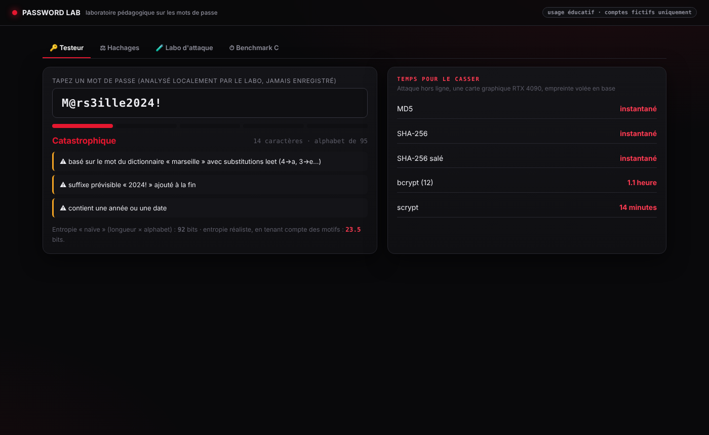
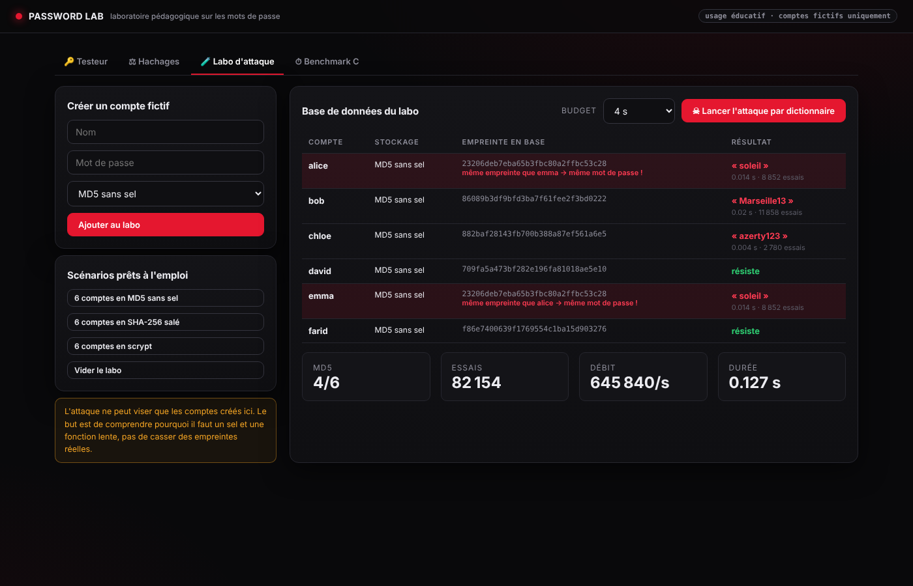
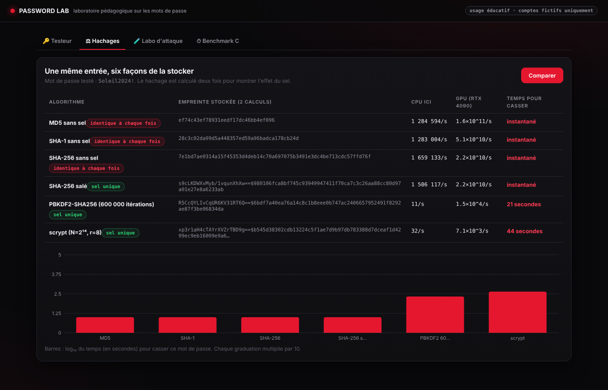

# 🔑 Password Lab

> Laboratoire pédagogique qui montre concrètement les risques des mots de passe faibles et compare les méthodes de hachage.

| Testeur | Labo d'attaque | Comparateur |
|---|---|---|
|  |  |  |

## Quatre ateliers
1. **🔑 Testeur de robustesse** : entropie *naïve* (longueur × alphabet) comparée à l'entropie *réaliste*. Il détecte les mots du dictionnaire, les substitutions leet (`M@rs3ille`), les suffixes prévisibles (`2024!`), les dates, les suites de clavier, les répétitions et les phrases de passe, puis estime le temps de cassage sur un GPU moderne pour chaque algorithme.
2. **⚖ Comparateur de hachage** : le même mot de passe stocké de six façons (MD5, SHA-1, SHA-256 avec ou sans sel, PBKDF2 600 000 itérations, scrypt). On voit l'effet du **sel** (empreinte différente à chaque calcul), le débit CPU mesuré en direct et le débit GPU de référence.
3. **🧪 Labo d'attaque** : on crée des **comptes fictifs**, puis on lance une attaque par dictionnaire avec règles de mutation (majuscule, leet, suffixes numériques, années, symboles). Ce qu'on observe :
   - en MD5 sans sel, deux utilisateurs au même mot de passe ont **la même empreinte**, et un seul calcul teste tous les comptes à la fois ;
   - avec un sel, chaque compte doit être attaqué séparément ;
   - avec scrypt ou PBKDF2, le débit chute de plusieurs ordres de grandeur.
4. **⏱ Benchmark C** : `bench/hashbench.c` mesure le débit réel de MD5, SHA-1, SHA-256, SHA-512 et PBKDF2 avec **OpenSSL EVP**.

> **Cadre éthique** : l'attaque ne peut viser que les comptes créés dans le laboratoire. Aucune empreinte externe ne peut être soumise.

## Lancer
```bash
pip install -r requirements.txt
make -C bench              # facultatif : benchmark en C (nécessite libssl-dev)
python app.py              # → http://127.0.0.1:5011
python -m pytest -q
```

## Stack
C (OpenSSL) · Python (Flask, hashlib : PBKDF2, scrypt) · JavaScript.

## À retenir
- Une fonction **lente et salée** (Argon2id, scrypt, bcrypt, PBKDF2 avec beaucoup d'itérations) pour stocker les mots de passe.
- Côté utilisateur, la **longueur et l'imprévisibilité** comptent plus que les symboles : une phrase de passe de cinq mots tirés au hasard bat `P@ssw0rd!`.
- Un mot de passe faible reste faible, même bien haché : scrypt le fait tenir 44 secondes au lieu d'un instant.

## Licence
MIT © Jimo0x
